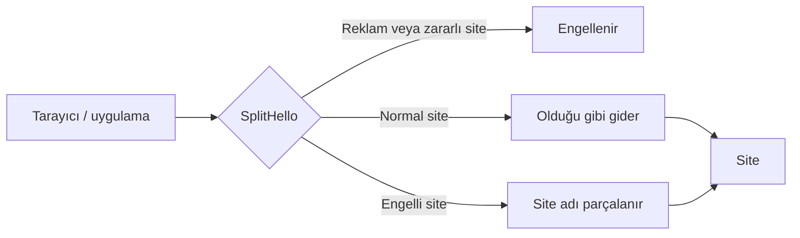
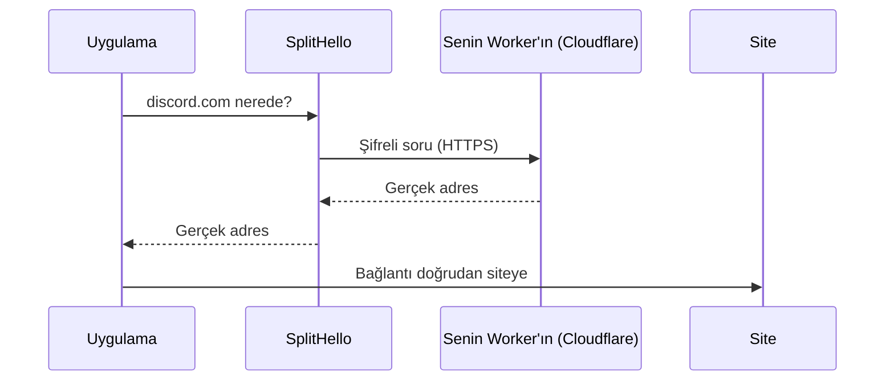

<div align="center">


# SplitHello

**Türkiye'deki erişim engellerini kendiliğinden aşar, reklamları ve izleyicileri engeller.**
VPN değil, aradan sunucu geçmez, internetin yavaşlamaz. Ücretsiz ve açık kaynak.

[**İndir (Windows 10/11)**](https://github.com/icguner/SplitHello/releases/latest) · [English](README.en.md)

</div>

---

## Ne işe yarar?

- 🔓 **Engelli siteleri açar.** Discord gibi erişime kapatılmış siteler ayar yapmadan açılır. Hangi sitenin nasıl açılacağını kendisi bulur ve hatırlar.
- 🛡️ **Reklam ve izleyici engeller.** AdGuard'daki gibi; tarayıcıda, oyunda, her uygulamada. Eklenti gerekmez.
- 🧠 **Ayar istemez.** Kur, bir kez Cloudflare'e izin ver, unut. Windows ile birlikte açılır, yönetici izni bir daha sormaz.
- 🪶 **Hafif.** Yaklaşık 27 MB bellek. Oyunlara, sesli sohbete ve 443 dışındaki trafiğe hiç dokunmaz.

<p align="center">
  
  
</p>

## Türkiye'de siteler nasıl engelleniyor?

İnternet sağlayıcıları iki yöntem kullanıyor. SplitHello ikisini de aşıyor:

| Engel | Ne oluyor? | SplitHello ne yapıyor? |
|---|---|---|
| **DNS engeli** | Siteyi sorduğunda sağlayıcı yanlış adres veriyor, site hiç açılmıyor. | Adres sorgusunu şifreleyip kendi Cloudflare Worker'ından soruyor, doğru adresi alıyor. |
| **DPI (SNI) engeli** | Bağlanırken gönderilen site adını sağlayıcının cihazı okuyor ve bağlantıyı kesiyor. | Site adını parçalara bölüyor; cihaz okuyamıyor, site normal açılıyor. |

## Nasıl çalışır?



1. Bir siteye bağlandığında SplitHello önce **hiçbir şeye dokunmadan** dener. Çalışıyorsa karışmaz.
2. Bağlantı kesiliyorsa site adını farklı yöntemlerle parçalayıp dener.
3. Çalışan yöntemi o ağ ve o site için **hatırlar**. Bir dahaki sefere site ilk denemede açılır.

Yanlış bir şey öğrenmemesi için engeli iki ayrı denemede görmeden kalıcı kaydetmez ve öğrendiklerini her yarım saatte bir yeniden kontrol eder.

## Worker nedir, neden gerekli?

Worker, **senin kendi** ücretsiz Cloudflare hesabında çalışan küçük bir koddur. Yalnızca site adreslerini (DNS) sormak için kullanılır.



- **Sağlayıcı DNS'i kurcalayamaz.** Onun gördüğü, senin `workers.dev` adresine yapılan sıradan bir HTTPS bağlantısıdır.
- **Trafiğin oradan geçmez.** Sayfalar, videolar, mesajlar doğrudan senin bilgisayarından siteye gider. Worker yalnızca adres sorar.
- **Senin.** Ortak bir sunucu yok. Worker rastgele bir gizli anahtarla korunur, başkası kullanamaz.
- **Ücretsiz.** Cloudflare'in ücretsiz planı normal kullanım için fazlasıyla yeter.
- **Kurulumu otomatik.** İlk açılışta tarayıcıda Cloudflare'e giriş yapıp izin vermen yeterli. Gerekirse **Bağlantı** sayfasından yeniden kurabilirsin.

Worker istemiyorsan tray menüsünden **DNS: Sistem** seç. Siteler yine parçalama ile açılır, ama DNS'i engellenen siteler açılmayabilir.

## Kurulum

1. [Sürümler sayfasından](https://github.com/icguner/SplitHello/releases/latest) `SplitHello-Setup-…exe` dosyasını indir ve çalıştır. Yönetici izni yalnızca burada, bir kez istenir.
2. İlk açılışta bir pencere açılır: tarayıcıda Cloudflare'e giriş yap ve **izin ver**. Bunun için bilgisayarında [Node.js](https://nodejs.org) kurulu olmalı. Ücretsiz bir Cloudflare hesabı yoksa açılan sayfadan oluşturabilirsin.
3. Hepsi bu. Saatin yanındaki SplitHello simgesi koruma durumunu gösterir. Çift tıklayınca panel açılır.

> Windows SmartScreen "tanınmayan uygulama" diyebilir, çünkü sürüm henüz imzalı değil. **Ek bilgi → Yine de çalıştır** ile devam edebilirsin. Kaynak kod bu repoda açık.

## Koruma özellikleri

Paneldeki **Koruma** sayfasından açıp kapatırsın:

| Özellik | Ne engeller? |
|---|---|
| 🚫 Reklam engelleme | Banner, video ve açılır pencere reklamları. Hafif / Normal / Pro / Pro++ seviyeleri var. |
| 👁️ İzleyici koruması | Windows ve Office telemetrisi, web izleyicileri |
| 💬 Rahatsız edici öğeler | Açılır pencere reklam ağları |
| ☁️ DNS koruması | Tüm adres sorguları şifreli, kendi Worker'ın üzerinden |
| 🌐 Gezinme güvenliği | Virüs, dolandırıcılık ve sahte alışveriş siteleri |
| 👨‍👩‍👧 Ebeveyn denetimi | Kumar ve yetişkin içerik (varsayılan kapalı) |

Listeler [HaGeZi](https://github.com/hagezi/dns-blocklists) projesinden gelir ve günde en fazla bir kez güncellenir. Yanlışlıkla engellenen bir siteyi panelde ya da tray menüsünde **Serbest bırak** ile tek tıkla açabilirsin.

## Performans

| | Değer |
|---|---|
| Bellek | ~27 MB (bütün listeler açıkken 40 MB'ın altında) |
| Bağlantı kurulurken eklenen süre | ~60 ms (normal site) |
| Engelli siteyi ilk kez çözmek | Birkaç saniye, sadece bir kez |
| Önceki (C++) sürüme göre | Yarı bellek, beşte bir thread |

## Sık sorulan sorular

**VPN mi bu?**
Hayır. Trafiğin başka bir ülkeye ya da sunucuya gitmez, IP adresin değişmez. Sadece bağlantının engellenen kısmı değiştirilir.

**Oyunları ya da Discord sesini etkiler mi?**
Hayır. Yalnızca HTTPS (443) trafiğine bakılır; oyun ve ses trafiği hiç dokunulmadan geçer.

**Her engeli aşar mı?**
DNS ve site adı (SNI) tabanlı engellerin büyük çoğunluğunu aşar. Türkiye'de en yaygın yöntemler bunlar. Doğrudan IP adresi engellenmişse **Bağlantı → Tünel yedeği** açılabilir; o zaman yalnızca açılamayan bağlantılar Worker üzerinden geçer.

**Güvenli mi?**
Kaynak kodu açık. Hiçbir veri dışarı gönderilmez; istatistikler yalnızca senin bilgisayarında tutulur. Worker'ın gizli anahtarı Windows'un şifrelemesiyle saklanır. SplitHello bir sorunla durursa trafik normal yoluna döner, internetin kesilmez.

**Çerez uyarılarını da kapatır mı?**
Hayır. Onlar sayfanın kendi içindedir; bunun için bir tarayıcı eklentisi gerekir.

**Nasıl kaldırırım?**
Windows Ayarlar → Uygulamalar → SplitHello → Kaldır. Ayarlarını da silmek isteyip istemediğin sorulur.

## Geliştiriciler için

Teknik ayrıntılar (mimari, ölçümler, komut satırı seçenekleri, derleme) [İngilizce README](README.en.md)'de. Kısaca:

```
cargo build --release
installer\fetch-windivert.ps1
installer\build.ps1
```

## Lisans

MIT. WinDivert kendi lisansıyla (LGPLv3/GPLv2) gelir. HaGeZi listeleri (GPL-3.0) çalışırken indirilir, pakette yer almaz.
