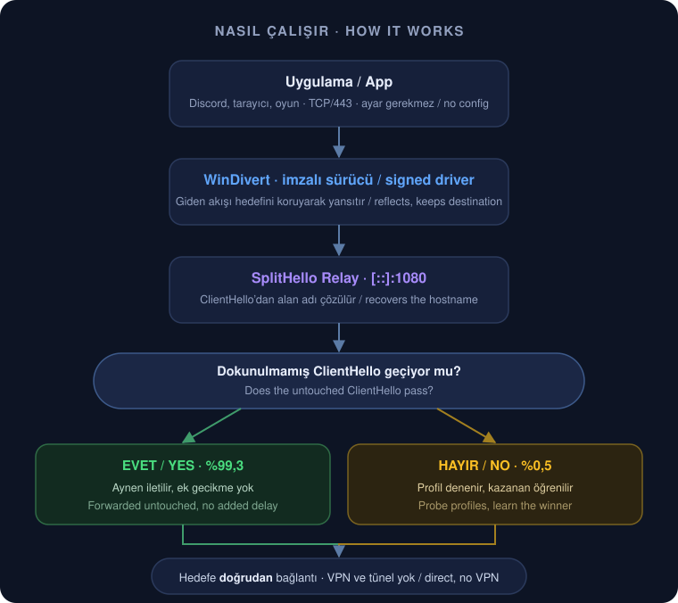
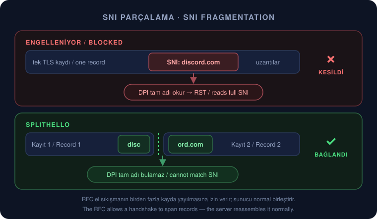
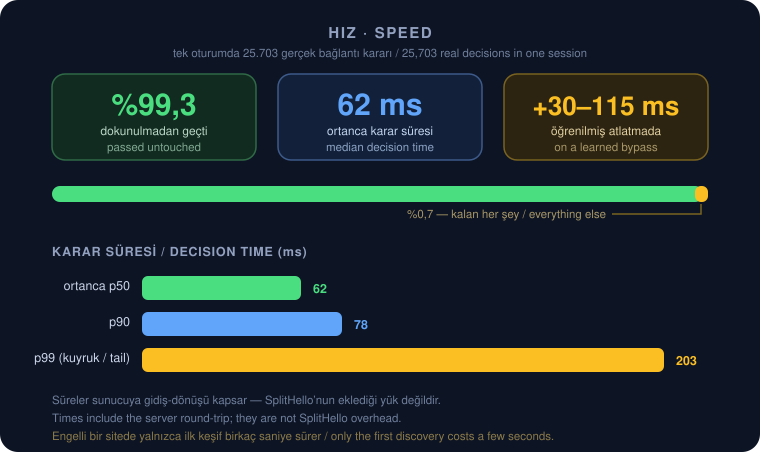
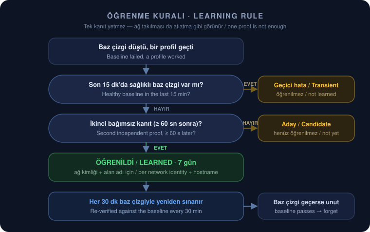

# SplitHello

**TR** — Windows için VPN'siz DPI teşhis ve atlatma aracı. Her ağ ve alan adı için işe yarayan **en az müdahaleci** yöntemi kendi öğrenir; zaten çalışan trafiğe hiç dokunmaz.

**EN** — VPN-free DPI diagnosis and bypass for Windows. It learns the **least invasive** method that works per network and hostname, and leaves already-working traffic untouched.

---

## Ne işe yarar? / What it does

**TR** — Türkiye'deki operatörler siteleri iki yolla engeller:

1. **DNS zehirlenmesi** — engelli alan adı için sahte IP döner.
2. **SNI denetimi** — DPI kutusu TLS ClientHello içindeki alan adını okur ve bağlantıyı keser.

SplitHello ikisini de VPN ya da veri yolunda uzak sunucu olmadan çözer.

**EN** — Turkish ISPs block sites two ways: DNS poisoning (fake IPs) and SNI inspection (DPI reads the hostname inside the TLS ClientHello). SplitHello handles both with no VPN and no remote relay on the data path.

---

## Nasıl çalışır? / How it works

<p align="center">
  
</p>

**TR** — Akış özeti: WinDivert giden 443 trafiğini yerel relay'e yansıtır, relay ClientHello'dan alan adını çıkarır, önce **hiç dokunmadan** dener. Geçerse iş biter. Geçmezse sınırlı bir profil kümesini dener ve çalışanı o ağ + alan adı için hatırlar.

**EN** — WinDivert reflects outbound 443 into the local relay. The relay recovers the hostname, tries the **untouched** ClientHello first, and only probes profiles if that fails. The winner is remembered per network + hostname.

---

## SNI parçalama / SNI fragmentation

**TR** — En çok işe yarayan aile, tek bir ClientHello'yu **geçerli birden fazla TLS kaydına** bölerek alan adını ikiye ayırır:

<p align="center">
  
</p>

**TR** — Bu standart dışı bir hile değil: RFC, el sıkışma mesajlarının birden fazla kayda yayılmasına izin verir. Sunucu normal birleştirir; aynı birleştirmeyi yapmayan DPI alan adını göremez.

**EN** — Not a protocol violation: the RFC allows handshake messages to span records. The server reassembles normally; DPI that doesn't, fails to read the SNI.

---

## Hız farkı var mı? / Is there a speed cost?

**TR — Normal sitelerde TLS verisi değiştirilmez, ancak ek gecikme olabilir.** Şeffaf mod bütün TCP/443 bağlantılarını yerel relay'e yönlendirir. Aşağıdaki sayılar geliştirme makinesinde tek oturumda ölçülen **25.703 bağlantının TLS profil kararlarından** geliyor; DNS çözümleme, hedefe TCP bağlantısı ve relay üzerinden veri aktarımı bu ölçümün dışında kalır.

**EN — Ordinary sites keep their TLS bytes, but may incur added latency.** Transparent mode routes all TCP/443 connections through the local relay. The numbers below cover **TLS profile decisions for 25,703 connections** in one development session; they exclude DNS resolution, upstream TCP connection and relay transfer overhead.

<p align="center">
  
</p>

| | TR | EN | Ölçüm / Measured |
|---|---|---|---|
| **Normal site** | TLS baytları değişmez; relay'den geçer | TLS bytes unchanged; still relayed | karar ortancası **62 ms** / decision median 62 ms |
| **Yoğun kuyruk** | Yavaş sunucular dahil | Including slow origins | p90 **78 ms** · p99 **203 ms** |
| **Öğrenilmiş engelli site** | Hatırlanan profil ilk denenir | Learned profile tried first | **+30–115 ms** |
| **İlk keşif (engelli)** | Profiller taranırken bir kez | One-off while probing | **birkaç saniye / a few seconds** |

**TR** — Bağlantıların **%99,3'ünde ClientHello baytları değişmedi**; yalnızca **%0,5'i** bir profile ihtiyaç duydu. Bu oran, normal sitelerde sıfır maliyet olduğu anlamına gelmez: bağlantı yine relay üzerinden geçer. Oyun ve ses trafiği (443 dışı) hiç dokunulmadan geçer; UDP/443 varsayılan olarak serbesttir. Alan adına göre seçici yönlendirme için gereken mimari [ayrı bir notta](docs/selective-routing.md) açıklanıyor.

**EN** — **99.3%** of ClientHello payloads were unchanged; only **0.5%** needed a profile. This is not evidence of zero overhead for ordinary sites: their connections still traverse the relay. Non-443 game and voice traffic is untouched, and UDP/443 passes by default. A [design note](docs/selective-routing.md) explains what domain-selective routing requires.

---

## Öğrenme mantığı / Learning logic

**TR** — Tek bir başarısızlık kanıt sayılmaz. Ağ takılmaları baz çizgiyi de denenen profili de düşürür ve bu, başarılı bir atlatma gibi görünür. Bu yüzden öğrenme **iki bağımsız kanıt** ister.

**EN** — One failure is not evidence. A network hiccup fails the baseline *and* the profile tried during it, which looks exactly like a successful bypass. Learning therefore requires **two independent confirmations**.

<p align="center">
  
</p>

**TR** — Öğrenilen kayıtlar Windows ağ kimliğine göre ayrılır (evdeki kural mobil hotspot'ta kullanılmaz), 7 gün sonra düşer ve **30 dakikada bir** dokunulmamış baz çizgiye karşı yeniden sınanır. Baz çizgi tekrar geçerse kayıt hemen silinir; böylece yanlış bir öğrenme en geç bir saat içinde kendini düzeltir.

**EN** — Learned entries are scoped to the Windows network identity, expire after 7 days, and are **re-verified every 30 minutes** against the untouched baseline. If the baseline passes again the entry is dropped at once, so a false positive corrects itself within the hour.

---

## Mimari / Architecture

**TR** — Veri yolunda VPN, tünel ya da uzak sunucu yok; hedefe doğrudan bağlanılır. Cloudflare Worker normalde **yalnızca DNS** için kullanılır. Her bağlantıya tek bir iş parçacığı bakar, eşzamanlı bağlantı 1.024 ile sınırlıdır, 10 dakika veri akmayan bağlantı kapanır ve kapanışta tüm bağlantılar iptal edilip iş parçacıkları beklenir.

**EN** — No VPN, tunnel or remote server on the data path. The Worker normally serves **DNS only**. One owned thread per connection, capped at 1,024 live connections, idle flows closed after 10 minutes, and shutdown aborts every connection and joins its thread.

---

## DNS

**TR** — Varsayılan **Worker DNS** modunda UDP/53 şeffaf yakalanır. A/AAAA sorguları ortak bir çift yığın önbelleği besler; diğer sorgu tipleri özgün mesajı bozmadan kimlik doğrulamalı Worker üzerinden gider. HTTPS/SVCB (tip 65), ECH ayarları ve DNS hata kodları uygulamaya olduğu gibi ulaşır. Tepsi menüsündeki **DNS: Sistem (Worker'sız)** seçeneği DNS/53'ü yakalamaz, Worker isteği ve tüneli açmaz; DPI profilleri TCP/443 üzerinde çalışmaya devam eder. Sistem DNS'i zehirleniyorsa bu mod engelli siteler için uygun olmayabilir. Seçim kaydedilir ve ağ motoru yeniden başlatılır.

**EN** — The default **Worker DNS** mode transparently captures UDP/53. A/AAAA warms a shared dual-stack cache; other query types pass through an authenticated Worker with the original wire message intact. HTTPS/SVCB (type 65), ECH config and DNS error codes reach the app unchanged. The tray menu's **DNS: Sistem (Worker'sız)** option leaves DNS/53 untouched and disables Worker requests and tunneling while keeping TCP/443 DPI profiles active. It may fail for blocked sites when the system resolver is poisoned. The choice is saved and restarts the network engine.

---

## Kurulum / Setup

**Gereksinimler / Requirements:** Windows 10/11 · CMake 3.20+ · Visual Studio (C++ workload) · yönetici yetkisi / admin rights. Worker DNS kurulumu için ayrıca Node.js 20+ ve ücretsiz Cloudflare hesabı gerekir / Worker DNS setup additionally needs Node.js 20+ and a free Cloudflare account.

```bash
cmake -B build -S .
cmake --build build --config Release
ctest --test-dir build -C Release
```

```bash
build\Release\splithello.exe --setup   # Cloudflare OAuth + Worker deploy
build\Release\splithello.exe           # normal çalıştırma / normal run
```

**TR** — `--setup` tarayıcıda Cloudflare oturumu açar, rastgele bir paylaşılan sır üretir, Worker'ı yayınlar ve sırrı DPAPI ile şifreleyip saklar. Worker olmadan başlamak için config.json içine `"dns_mode": "system"` yazılabilir. Normal çalıştırmada bir UAC istemi çıkar ve uygulama sistem tepsisine yerleşir; ikonuna çift tıklamak tanılama panelini açar.

**EN** — `--setup` runs the Cloudflare OAuth flow, generates a shared secret, deploys the Worker and stores the secret encrypted with DPAPI. A normal run shows one UAC prompt and lives in the tray; double-click opens the diagnostics dashboard.

<details>
<summary><b>Seçenekler / Options</b></summary>

```
--setup              Cloudflare hesabını bağla ve Worker deploy et
--redeploy           Worker kodunu güncelle, gizli anahtarı yenile
--worker <url>       Worker URL'sini elle belirt
--port <port>        Relay portu (varsayılan: 1080)
--split-delay <ms>   TLS kayıt parçaları arası bekleme (varsayılan: 20)
--strategy <ad>      Tanılama: profili sabitle, öğrenmeyi kapat
--tunnel-fallback    Tüm profiller başarısızsa Worker tünelini kullan
--manual-proxy       WinDivert'sız, SOCKS5/CONNECT dinle
--quic-mode <mod>    allow (varsayılan), adaptive veya block
--allow-quic         Eski ad; --quic-mode allow ile aynı
--include-process <desen>  Yalnız eşleşen exe'leri işle (tekrarlanabilir)
--exclude-process <desen>  Eşleşen exe'leri atla (tekrarlanabilir)
--restore-proxy      Çökme sonrası kalan proxy yedeğini geri yükle ve çık
--forget-token       Eski sürümden kalan API token alanını sil ve çık
--forget-strategies  Öğrenilen alan adı profillerini sıfırla ve çık
--list-strategies    Profilleri listele ve çık
--console            Tepsi yerine konsolda çalıştır
--verbose            Konsolda ayrıntılı log (konsol modunu açar)
--help               Yardımı göster
```

**TR** — `--manual-proxy` WinDivert'i hiç açmaz; bu yüzden `--quic-mode`, `--allow-quic` ve süreç filtreleri (`--include-process`, `--exclude-process`) bu modda etkisizdir. `--tunnel-fallback`, DNS modu **Sistem (Worker'sız)** iken yok sayılır (Worker kullanılmadığı için tünel de yoktur). `--include-process`/`--exclude-process` boş ya da 1.024 bayttan uzun desenleri reddeder.

**EN** — `--manual-proxy` never opens WinDivert, so `--quic-mode`, `--allow-quic` and the process filters are inert in that mode. `--tunnel-fallback` is ignored in **System (no Worker)** DNS mode because no Worker tunnel exists there. `--include-process`/`--exclude-process` reject empty or over-1,024-byte patterns.
</details>

<details>
<summary><b>Süreç kapsamı / Process scope</b></summary>

**TR** — Hangi uygulamaların kapsanacağı sınırlanabilir. Dışlama kuralları her zaman kazanır; dahil etme listesi doluysa eşleşmeyen süreçler normal Windows yolunda kalır.

```json
{
  "process_include": ["chrome.exe", "firefox*.exe"],
  "process_exclude": ["steam*.exe", "C:\\Games\\Legacy\\*"]
}
```

**TR** — `process_include` dolu ama hiçbir girdisi geçerli değilse (ör. yalnızca boş dizeler) kapsam "tüm süreçler"e **genişletilmez**: ağ motoru başlamaz, trafik normal Windows yolunda kalır ve tepsi nedenini bildirir. Listeyi düzeltin ya da boşaltın. Komut satırından verilen `--include-process`/`--exclude-process` kuralları yalnızca o çalıştırma için motora eklenir; panelde düzenlenemez, panel yalnızca sayısını gösterir.

**EN** — If `process_include` is non-empty but none of its entries is usable (for example only empty strings), the scope is **not** widened to all processes: the engine refuses to start, traffic stays on the normal Windows path and the tray says why. Fix or clear the list. Rules passed on the command line are merged into the engine for that run only; the dashboard cannot edit them and only shows how many there are.
</details>

<details>
<summary><b>Windows ile başlat ve hatalar / Start with Windows and failures</b></summary>

**TR** — Tepsi menüsündeki **Windows ile başlat**, oturum açılışında yönetici yetkisiyle çalışan bir zamanlanmış görev kaydeder (süre sınırı yok, pilde de çalışır). Bu görev exe'yi her oturumda yükseltilmiş çalıştıracağı için yalnızca standart kullanıcıların değiştiremeyeceği bir konumdan (ör. `C:\Program Files\SplitHello`) etkinleştirilir; kullanıcı klasörü ya da masaüstü gibi yazılabilir konumlarda reddedilir ve nedeni gösterilir. Kapatmak her konumdan çalışır.

Ağ motoru başlayamazsa tepsi nedenini gösterir (port kullanımda, WinDivert açılamadı/`WinDivert.dll` yok, geçersiz süreç kuralları, Worker kurulumu yok, yapılandırma okunamadı). 10 saniyede başlamayan ya da durmayan motor sonlandırılır; sürücü kapanınca filtre kalkar ve internet normale döner. Çözülemeyen şifreli Worker sırrı (başka Windows kullanıcısı gibi) config'ten silinmez, uyarı loglanır.

**EN** — **Windows ile başlat** in the tray menu registers a logon scheduled task that runs elevated (no execution time limit, also on battery). Because it launches the exe elevated every session, it only enables from a location standard users cannot modify (e.g. `C:\Program Files\SplitHello`); user-writable places such as a profile folder or the desktop are refused with an explanation. Disabling works from anywhere.

If the engine cannot start the tray shows why (port in use, WinDivert could not open / `WinDivert.dll` missing, invalid process rules, Worker setup missing, config unreadable). An engine that does not start or stop within 10 seconds is terminated; closing the driver handle removes the filter and traffic returns to normal. A Worker secret that cannot be decrypted (for example one written by another Windows user) is kept in config.json untouched and a warning is logged.
</details>

---

## Profiller / Profiles

| Profil | Ne yapar / What it does |
|---|---|
| `none` | Dokunulmamış ClientHello — baz çizgi / untouched baseline |
| `sni-mid` | Alan adının ortasından böler / cut mid-hostname |
| `record-1` | İlk bayttan sonra böler / cut after first byte |
| `packet-reverse` | TCP parçalarını ters sırada gönderir / reversed segments |
| `packet-ipfrag` | IPv4 paketini böler / IPv4 fragmentation |
| `packet-fake-*` | Sahte kapak ClientHello (bad seq / checksum) |
| `packet-autottl` | Kapak paketi sunucudan önce ölür / expires before server |
| `sni-pre`, `sni-multi`, `sni-mid-slow` | Farklı kesim noktaları / other cut points |

**TR** — Bir profil yalnızca **eksiksiz bir ServerHello** geldiyse "çalıştı" sayılır. TLS Alert, engel sayfası, yarım kayıt, sessiz düşüş ve RST ayrı teşhis sinyalleridir.

**EN** — A profile only "worked" after a **complete ServerHello**. Alerts, block pages, partial records, silent drops and RST are separate diagnostic signals.

---

## GoodbyeDPI'dan farkı / vs GoodbyeDPI

| | GoodbyeDPI | SplitHello |
|---|---|---|
| **Yöntem / Method** | Sabit paket hileleri / fixed packet tricks | Farksal baz çizgi + öğrenen profil kümesi / differential baseline + learned profiles |
| **DNS** | Ele almaz / not handled | Worker DNS: şeffaf DoH; sistem modu: DNS'e dokunmaz |
| **Kapsam / Scope** | Filtreye bağlı / filter-dependent | Tüm TCP/443; UDP/443 serbest / untouched |
| **Oyun etkisi / Gaming** | Geniş trafiği etkileyebilir | 443 dışı trafik hiç dokunulmaz / untouched |
| **Kanıt / Evidence** | Yok / none | Yerel SQLite teşhis kaydı + panel |

---

## Güvenlik / Security

- **TR** Worker uç noktaları `Bearer` sır ister; sır olmadan Worker kapalı çalışır (açık DNS proxy'ye dönüşmez). **EN** Worker endpoints require a bearer secret and fail closed.
- **TR** Relay yalnızca WinDivert'in SYN kaydında gördüğü bağlantıyı kabul eder — açık proxy değildir. **EN** The relay only accepts connections present in the short-lived SYN registry.
- **TR** Cloudflare oturumu Wrangler keyring'inde durur; SplitHello okumaz. Worker sırrı DPAPI ile şifrelenir. **EN** OAuth stays in Wrangler's keyring; the Worker secret is DPAPI-encrypted.
- **TR** WinDivert 2.2.2 sabit SHA-256 ile indirilir; uyuşmazlık derlemeyi durdurur. **EN** WinDivert is pinned by SHA-256; a mismatch fails configure.
- **TR** Ağ yolu fail-open: sürücü ya da relay ölürse filtre kalkar, internet normale döner. **EN** Fail-open: if the driver or relay dies, the filter is removed and traffic returns to normal.
- **TR** Telemetri yalnızca yereldir, hiçbir zaman yüklenmez. **EN** Telemetry is local only and never uploaded.

---

## Teknik özet / Technical summary

- **Dil / Language:** C++20 · spdlog + SQLite + WinDivert 2.2.2 (otomatik indirilir / auto-fetched)
- **Giriş / Ingress:** WinDivert TCP/443 (IPv4 + IPv6); UDP/443 varsayılan serbest / passthrough
- **Yedek yol / Fallback:** `--manual-proxy` ile SOCKS5 + HTTP CONNECT
- **Dosyalar / Files:** `%APPDATA%\splithello\` → `config.json` · `strategies.json` (1.000 kayıt, 7 gün) · `telemetry.db` (30 gün) · `splithello.log` (512 KiB × 3)
- **Testler / Tests:** `ctest --test-dir build -C Release` — TLS ayrıştırma, teşhis sınıflandırması, profil planlama ve yeniden doğrulama, telemetri şema geçişi, süreç kuralları, şeffaf yönlendirme ve bağlantı yaşam döngüsü (pompa, sınır, boşta zaman aşımı, kapanışta bekleme)

### Fuzzing

```bash
cmake -S fuzz -B build-fuzz -G Ninja -DCMAKE_BUILD_TYPE=RelWithDebInfo -DCMAKE_CXX_COMPILER=clang++
cmake --build build-fuzz --parallel
./build-fuzz/fuzz_tls -max_total_time=60 -dict=fuzz/tls.dict
```

**TR** — `fuzz/` derlemesi üç güvenilmez girdi yüzeyini hedefler: TLS kayıtları, DNS mesajları ve JSON. CI her push'ta Windows Release testlerini ve bir ASan fuzz smoke işini çalıştırır.

**EN** — The `fuzz/` build targets the three untrusted-input surfaces: TLS records, DNS messages and JSON. CI runs Windows Release tests plus an ASan fuzz smoke job on every push.

---

## Henüz yok / Not yet

- İmzalı sürümler ve otomatik güncelleme / signed releases and auto-update
- Tam QUIC Initial şifre çözme ve CRYPTO parçalama. Şu anki adaptif QUIC modu yalnızca düşük riskli ön hazırlık ve ölçülü TCP'ye düşüş uygular. / Full QUIC Initial decryption and CRYPTO-frame fragmentation; the current adaptive mode only does the pre-Initial prime and a measured TCP fallback.

---

## Lisans / License

**TR** — SplitHello MIT lisanslıdır. WinDivert kendi LGPLv3/GPLv2 ikili lisansıyla ayrıca dağıtılır ve `WinDivert-LICENSE.txt` her derlemenin yanına kopyalanır. SQLite kamu malıdır. Panel Windows'un kendi Direct2D/DirectWrite bileşenleriyle çizilir, üçüncü parti arayüz çalışma zamanı paketlenmez.

**EN** — SplitHello is MIT licensed. WinDivert ships under its own LGPLv3/GPLv2 dual license (`WinDivert-LICENSE.txt` is copied beside every build). SQLite is public domain. The dashboard uses Windows' own Direct2D/DirectWrite, so no third-party UI runtime is bundled.
