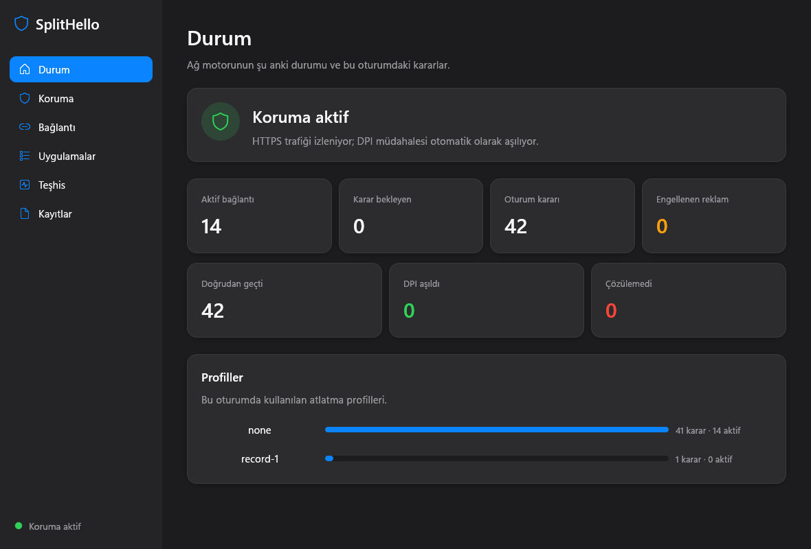
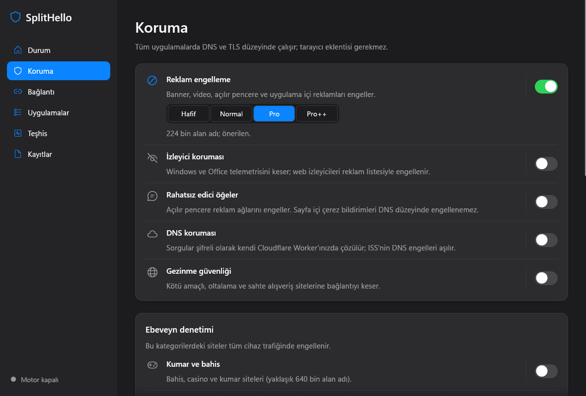
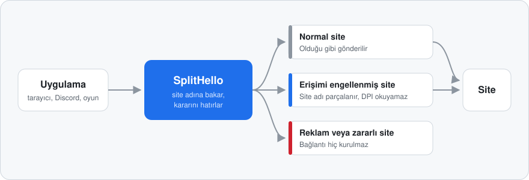
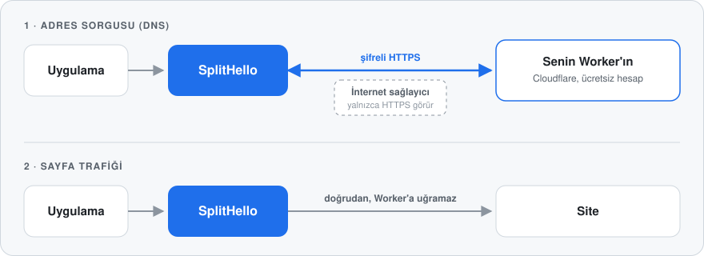

<div align="center">

<picture>
  <source media="(prefers-color-scheme: dark)" srcset="assets/logo-dark.svg">
  
</picture>

# SplitHello

Türkiye'deki erişim engellerini kendiliğinden aşan, reklam ve izleyicileri engelleyen Windows uygulaması.
VPN değildir; trafiğin başka bir sunucudan geçmez.

[İndir](https://github.com/icguner/SplitHello/releases/latest) · [Nasıl çalışır](#nasıl-çalışır) · [Sık sorulanlar](#sık-sorulan-sorular) · [English](README.en.md)

</div>

<p align="center">
  
  
</p>

## Öne çıkanlar

| | |
|---|---|
| **Engelli siteleri açar** | Erişimi engellenmiş siteler ayar yapmadan açılır. Hangi sitenin hangi yöntemle açıldığını öğrenir ve hatırlar. |
| **Reklam ve izleyici engeller** | Tarayıcıda, oyunda ve diğer bütün uygulamalarda çalışır; eklenti gerekmez. |
| **Kur ve unut** | Windows ile açılır. Yönetici izni yalnızca kurulumda bir kez istenir. |
| **Hafif** | Yaklaşık 27 MB bellek kullanır. Oyun ve sesli sohbet trafiğine dokunmaz. |

## Türkiye'de siteler nasıl engelleniyor?

İnternet sağlayıcıları iki yöntem kullanır. SplitHello ikisini de aşar.

| Engel | Ne olur? | SplitHello ne yapar? |
|---|---|---|
| **DNS engeli** | Site adresini sorduğunda sağlayıcı yanlış adres döner, site açılmaz. | Sorguyu şifreleyip kendi Cloudflare Worker'ına sorar ve gerçek adresi alır. |
| **DPI (SNI) engeli** | Bağlanırken gönderilen site adını sağlayıcının cihazı okur ve bağlantıyı keser. | Site adını parçalara böler. Cihaz adı okuyamaz, site normal açılır. |

## Nasıl çalışır?

<p align="center">
  
</p>

1. Her bağlantı önce **hiç değiştirilmeden** denenir. Çalışıyorsa SplitHello karışmaz.
2. Bağlantı kesiliyorsa site adı farklı yöntemlerle parçalanarak tekrar denenir.
3. Çalışan yöntem o ağ ve o site için kaydedilir; site bir dahaki sefere ilk denemede açılır.

Yanlış bir şey öğrenmemek için engel iki ayrı denemede görülmeden kayıt yapılmaz. Kayıtlar yarım saatte bir yeniden kontrol edilir.

## Worker nedir?

Worker, kendi ücretsiz Cloudflare hesabında çalışan küçük bir programdır. Yalnızca site adreslerini (DNS) sormak için kullanılır.

<p align="center">
  
</p>

- **Sağlayıcı DNS'e karışamaz.** Gördüğü şey, kendi `workers.dev` adresine yapılan sıradan bir HTTPS bağlantısıdır.
- **Trafiğin oradan geçmez.** Sayfalar, videolar ve mesajlar doğrudan bilgisayarından siteye gider.
- **Hesap senin.** Ortak bir sunucu yoktur. Worker rastgele bir gizli anahtarla korunur, başkası kullanamaz.
- **Ücretsiz.** Cloudflare'in ücretsiz planı normal kullanım için yeterlidir.

Worker kurmak istemezsen tray menüsünden **DNS: Sistem** seçebilirsin. Siteler yine parçalama ile açılır, ancak DNS ile engellenen siteler açılmayabilir.

## Kurulum

1. [Sürümler sayfasından](https://github.com/icguner/SplitHello/releases/latest) `SplitHello-Setup-…exe` dosyasını indir ve çalıştır. Yönetici izni yalnızca bu adımda istenir.
2. İlk açılışta bir pencere açılır. Tarayıcıda Cloudflare hesabına giriş yap ve izin ver. Bu adım için [Node.js](https://nodejs.org) kurulu olmalıdır; Cloudflare hesabın yoksa açılan sayfadan ücretsiz oluşturabilirsin.
3. Kurulum bitti. Saatin yanındaki simge koruma durumunu gösterir, çift tıklayınca panel açılır.

Windows SmartScreen uyarı verirse **Ek bilgi → Yine de çalıştır** ile devam edebilirsin. Sürümler henüz imzalı değildir; kaynak kodun tamamı bu depodadır.

## Koruma özellikleri

Paneldeki **Koruma** sayfasından açılıp kapatılır.

| Özellik | Engellenenler |
|---|---|
| Reklam engelleme | Banner, video ve açılır pencere reklamları. Hafif, Normal, Pro ve Pro++ seviyeleri vardır. |
| İzleyici koruması | Windows ve Office telemetrisi, web izleyicileri |
| Rahatsız edici öğeler | Açılır pencere reklam ağları |
| DNS koruması | Bütün adres sorguları kendi Worker'ın üzerinden, şifreli |
| Gezinme güvenliği | Zararlı yazılım, dolandırıcılık ve sahte alışveriş siteleri |
| Ebeveyn denetimi | Kumar ve yetişkin içerik (varsayılan olarak kapalı) |

Listeler [HaGeZi](https://github.com/hagezi/dns-blocklists) projesinden alınır ve günde en fazla bir kez güncellenir. Yanlışlıkla engellenen bir site panelden veya tray menüsünden **Serbest bırak** ile açılabilir.

## Performans

| Ölçüm | Değer |
|---|---|
| Bellek | Yaklaşık 27 MB; bütün listeler açıkken 40 MB'ın altında |
| Bağlantı kurulurken eklenen süre | Normal sitelerde genellikle 60 ms civarı |
| Engelli bir siteyi ilk kez çözmek | Birkaç saniye, yalnızca bir kez |
| Önceki sürüme göre | Yarı bellek, beşte bir iş parçacığı |

## Sık sorulan sorular

**VPN mi?**
Hayır. Trafiğin başka bir ülkeye veya sunucuya gitmez, IP adresin değişmez. Yalnızca bağlantının engellenen kısmı değiştirilir.

**Oyunları veya sesli sohbeti etkiler mi?**
Hayır. Yalnızca HTTPS (443) trafiğine bakılır; oyun ve ses trafiği olduğu gibi geçer.

**Her engeli aşar mı?**
Türkiye'de en yaygın olan DNS ve site adı (SNI) tabanlı engellerin büyük çoğunluğunu aşar. Bir sitenin IP adresi doğrudan engellenmişse **Bağlantı → Tünel yedeği** açılabilir; bu durumda yalnızca açılamayan bağlantılar Worker üzerinden geçer.

**Güvenli mi?**
Kaynak kodu açıktır. Hiçbir veri dışarı gönderilmez; istatistikler yalnızca kendi bilgisayarında tutulur. Worker'ın gizli anahtarı Windows'un şifreleme altyapısıyla saklanır. SplitHello bir hata nedeniyle durursa trafik normal yoluna döner, internet kesilmez.

**Çerez uyarılarını da kapatır mı?**
Hayır. Çerez uyarıları sayfanın içindedir; bunlar için bir tarayıcı eklentisi gerekir.

**Nasıl kaldırılır?**
Ayarlar → Uygulamalar → SplitHello → Kaldır. Ayarların silinip silinmeyeceği ayrıca sorulur.

## Geliştiriciler için

Mimari, ölçüm ayrıntıları, komut satırı seçenekleri ve derleme adımları [İngilizce README](README.en.md)'de yer alır.

```
cargo build --release
installer\fetch-windivert.ps1
installer\build.ps1
```

## Lisans

MIT. WinDivert kendi lisansıyla (LGPLv3/GPLv2) dağıtılır. HaGeZi listeleri (GPL-3.0) çalışma sırasında indirilir, paketin içinde yer almaz.
